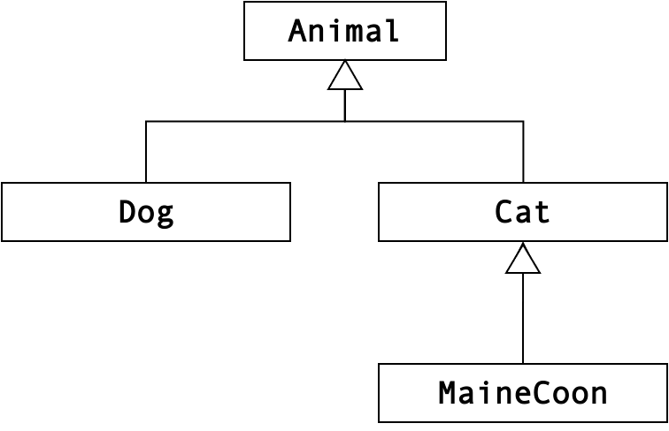

# Wildcards - Examples
#### Object Oriented Programming - Prof. Tiziano Leidi - Bachelor in Computer Science - SUPSI

---

## Circus example (part 1)

The subsequent example program fails to compile.

Fix all compiler errors by adding the correct wildcards. Do not change:
 - the class hierarchy, 
 - the `Animal` classes (`Animal, Cat, MaineCoon, Dog`)
 - the `main` method.

Class hierarchy for reference:

<div><center></center></div>


```java
import java.util.ArrayList;
import java.util.List;

class Animal {
    private String name;

    public Animal(String name) {
        this.name = name;
    }

    public String getName() {
        return name;
    }

    public void jump() {
        System.out.println(getName() + " is jumping.");
    }
}

class Cat extends Animal {
    public Cat(String name) {
        super(name);
    }
    public void meow() {
        System.out.println(getName() + " is meowing.");
    }
}

class MaineCoon extends Cat {
    public MaineCoon(String name) {
        super(name);
    }
    public void meow() {
        System.out.println("Maine Coon" + getName() + " is meowing.");
    }
}

class Dog extends Animal {
    public Dog(String name) {
        super(name);
    }
    public void bark() {
        System.out.println(getName() + " is barking.");
    }
}

// Trainers

class AnimalTrainer {
    public void act(List<Animal> animalList) {
        for (Animal animal : animalList)
            animal.jump();
    }
}

class CatTrainer {
    public void act(List<Cat> catList) {
        for (Cat cat : catList)
            cat.meow();
    }
}

public class Circus {
    private static void circus1() {
        AnimalTrainer animalTrainer = new AnimalTrainer();
        List<Animal> animalList = new ArrayList<>();
        animalList.add(new Dog("Bob"));
        animalList.add(new Dog("Amy"));
        animalTrainer.act(animalList);
    }

    private static void circus2() {
        AnimalTrainer animalTrainer = new AnimalTrainer();
        List<Cat> catList = new ArrayList<>();
        catList.add(new Cat("Tim"));
        catList.add(new Cat("Lucy"));
        animalTrainer.act(catList);
    }
    
    public static void main(String[] args) {
        circus1();
        circus2();
    }
}
```

## Solution of the circus example (part 1)

Below is the solution of the preceding exercise.


```java
import java.util.ArrayList;
import java.util.List;

class Animal {
    private String name;

    public Animal(String name) {
        this.name = name;
    }

    public String getName() {
        return name;
    }

    public void jump() {
        System.out.println(getName() + " is jumping.");
    }
}

class Cat extends Animal {
    public Cat(String name) {
        super(name);
    }
    public void meow() {
        System.out.println(getName() + " is meowing.");
    }
}

class MaineCoon extends Cat {
    public MaineCoon(String name) {
        super(name);
    }
    public void meow() {
        System.out.println("Maine Coon" + getName() + " is meowing.");
    }
}

class Dog extends Animal {
    public Dog(String name) {
        super(name);
    }
    public void bark() {
        System.out.println(getName() + " is barking.");
    }
}

// Trainers
class AnimalTrainer {
    public void act(List<? extends Animal> animalList) {
        for (Animal animal : animalList)
            animal.jump();
    }
}

class CatTrainer {
    public void act(List<? extends Cat> catList) {
        for (Cat cat : catList)
            cat.meow();
    }
}

public class Circus {
    private static void circus1() {
        AnimalTrainer animalTrainer = new AnimalTrainer();
        List<Animal> animalList = new ArrayList<>();
        animalList.add(new Dog("Bob"));
        animalList.add(new Dog("Amy"));
        animalTrainer.act(animalList);
    }

    private static void circus2() {
        AnimalTrainer animalTrainer = new AnimalTrainer();
        List<Cat> catList = new ArrayList<>();
        catList.add(new Cat("Tim"));
        catList.add(new Cat("Lucy"));
        animalTrainer.act(catList);
    }

    public static void main(String[] args) {
        circus1();
        circus2();
    }
}
```

## Circus example (part 2)

The subsequent program introduces three extra classes: `DogKeeper`, `CatKeeper` and `CatTrainer`. The keeper classes are tasked with adding their respective animals to a collection provided as an argument to the `addDogs()` and `addCats()` methods.

As in the previous program, use the necessary wildcards to fix all compiler errors.


```java
import java.util.ArrayList;
import java.util.List;

class Animal {
    private String name;

    public Animal(String name) {
        this.name = name;
    }

    public String getName() {
        return name;
    }

    public void jump() {
        System.out.println(getName() + " is jumping.");
    }
}

class Cat extends Animal {
    public Cat(String name) {
        super(name);
    }
    public void meow() {
        System.out.println(getName() + " is meowing.");
    }
}

class MaineCoon extends Cat {
    public MaineCoon(String name) {
        super(name);
    }
    public void meow() {
        System.out.println("Maine Coon" + getName() + " is meowing.");
    }
}

class Dog extends Animal {
    public Dog(String name) {
        super(name);
    }
    public void bark() {
        System.out.println(getName() + " is barking.");
    }
}

// Trainers
class AnimalTrainer {
    public void act(List<Animal> animalList) {
        for (Animal animal : animalList)
            animal.jump();
    }
}

class CatTrainer {
    public void act(List<Cat> catList) {
        for (Cat cat : catList)
            cat.meow();
    }
}

// Keepers

class CatKeeper {
    public void addCats(List<Cat> animalList) {
        animalList.add(new Cat("Tim"));
        animalList.add(new Cat("Lucy"));
        animalList.add(new MaineCoon("Sally"));
    }
}

class DogKeeper {
    public void addDogs(List<Dog> animalList) {
        animalList.add(new Dog("Bob"));
        animalList.add(new Dog("Amy"));
    }
}

public class Circus {
    public static void main(String[] args) {
        List<Animal> animalList = new ArrayList<>();

        DogKeeper dogKeeper = new DogKeeper();
        dogKeeper.addDogs(animalList);

        CatKeeper catKeeper = new CatKeeper();
        catKeeper.addCats(animalList);

        // Animal trainer should be able to have each animal jump
        AnimalTrainer animalTrainer = new AnimalTrainer();
        animalTrainer.act(animalList);

        List<Cat> catList = new ArrayList<>();
        catKeeper.addCats(catList);
        CatTrainer catTrainer = new CatTrainer();
        catTrainer.act(catList);
    }
}
```

## Solution of the circus example (part 2)

Below is the solution of the preceding exercise.


```java
import java.util.ArrayList;
import java.util.List;

class Animal {
    private String name;

    public Animal(String name) {
        this.name = name;
    }

    public String getName() {
        return name;
    }

    public void jump() {
        System.out.println(getName() + " is jumping.");
    }
}

class Cat extends Animal {
    public Cat(String name) {
        super(name);
    }
    public void meow() {
        System.out.println(getName() + " is meowing.");
    }
}

class MaineCoon extends Cat {
    public MaineCoon(String name) {
        super(name);
    }
    public void meow() {
        System.out.println("Maine Coon" + getName() + " is meowing.");
    }
}

class Dog extends Animal {
    public Dog(String name) {
        super(name);
    }
    public void bark() {
        System.out.println(getName() + " is barking.");
    }
}

// Trainers
class AnimalTrainer {
    public void act(List<? extends Animal> animalList) {
        for (Animal animal : animalList)
            animal.jump();
    }
}

class CatTrainer {
    public void act(List<? extends Cat> catList) {
        for (Cat cat : catList)
            cat.meow();
    }
}

// Keepers
class CatKeeper {
    public void addCats(List<? super Cat> animalList) {
        animalList.add(new Cat("Tim"));
        animalList.add(new Cat("Lucy"));
        animalList.add(new MaineCoon("Sally"));
    }
}

class DogKeeper {
    public void addDogs(List<? super Dog> animalList) {
        animalList.add(new Dog("Bob"));
        animalList.add(new Dog("Amy"));
    }
}

public class Circus {
    public static void main(String[] args) {
        List<Animal> animalList = new ArrayList<>();

        DogKeeper dogKeeper = new DogKeeper();
        dogKeeper.addDogs(animalList);

        CatKeeper catKeeper = new CatKeeper();
        catKeeper.addCats(animalList);

        // Animal trainer should be able to have each animal jump
        AnimalTrainer animalTrainer = new AnimalTrainer();
        animalTrainer.act(animalList);

        List<Cat> catList = new ArrayList<>();
        catKeeper.addCats(catList);
        CatTrainer catTrainer = new CatTrainer();
        catTrainer.act(catList);
    }
}
```
