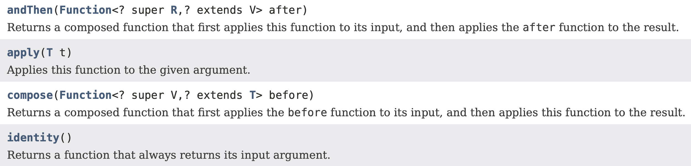
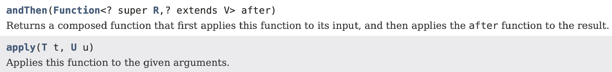
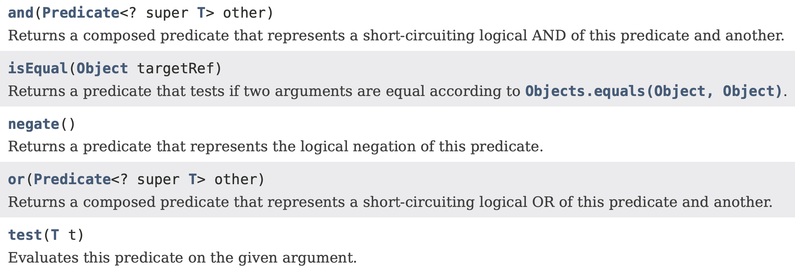
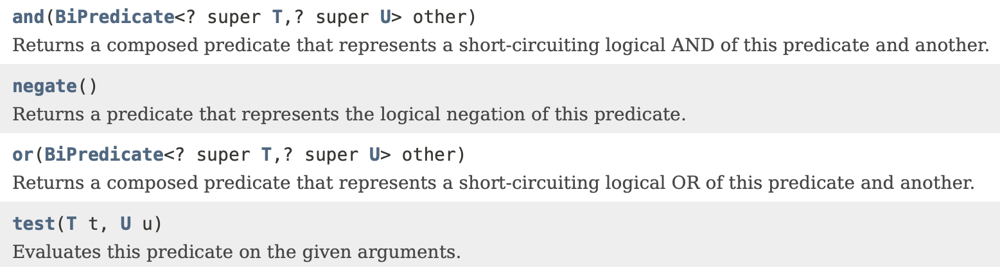

# Standard Functional Interfaces
#### Object Oriented Programming - Prof. Tiziano Leidi - Bachelor in Computer Science - SUPSI

---

## Standard functional interfaces

Java offers a wide range of standard interfaces that can serve as functional interfaces. Frequently encountered standard functional interfaces include:

| Interface name      | Arguments | Returns   | Example                              |
|---------------------|-----------|-----------|--------------------------------------|
| `Predicate<T>`      | `T`       | `boolean` | Has this album been released yet?    |
| `Consumer<T>`       | `T`       | `void`    | Printing out a value                 |
| `Function<T,R>`     | `T`       | `R`       | Get the name from an `Artist` object |
| `Supplier<T>`       | None      | `T`       | A factory method                     |
| `UnaryOperator<T>`  | `T`       | `T`       | Logical not (`!`)                    |
| `BinaryOperator<T>` | `(T, T)`  | `T`       | Multiplying two numbers (`*`)        |

These standard functional interfaces are extensively used within the Java library classes. Here, you'll find examples in methods provided by `List`:

Method signatures:

```java
boolean removeIf(Predicate<? super E> filter);

void replaceAll(UnaryOperator<E> operator);
```

Example of usage:

```java
List<Integer> numbers = new ArrayList<>();
numbers.add(1);
numbers.add(2);
numbers.add(3);

numbers.removeIf(n -> n % 2 == 0);

numbers.replaceAll(n -> n * n);
```

## Function and BiFunction

A `Function` accepts an argument of type `T` and returns an object of type `R`.

```java
@FunctionalInterface
public interface Function<T, R> {
   R apply(T t);
}
```

A `BiFunction` is similar, but it accepts two arguments and returns an object.

```java
@FunctionalInterface
public interface BiFunction<T, U, R> {
   R apply(T t, U u);
}
```

Examples:


```Java
Function<String, Integer> func = x -> x.length();
System.out.println(func.apply("Example"));

// takes two Integers and returns an Integer
BiFunction<Integer, Integer, Integer> func1 = (x1, x2) -> x1 + x2;
System.out.println(func1.apply(2, 3));

// takes two Integers and returns an Double
BiFunction<Integer, Integer, Double> func2 = (x1, x2) -> Math.pow(x1, x2);
System.out.println(func2.apply(2, 4));

// takes two Integers and returns a List<Integer>
BiFunction<Integer, Integer, List<Integer>> func3 = (x1, x2) -> Arrays.asList(x1 + x2);
System.out.println(func3.apply(2, 3));
```

Available `Function` methods:

<div><center></center></div>

Available `BiFunction` methods: 

<div><center></center></div>

## Predicate and BiPredicate

A `Predicate` takes an argument and returns a boolean value. It is commonly used to apply filtering criteria to a collection of objects.

```java
@FunctionalInterface
public interface Predicate<T> {
   boolean test(T t);
}
```

A `BiPredicate` accepts two arguments and returns a boolean value. Its behavior is equivalent to that of a `Predicate`.

```java
@FunctionalInterface
public interface BiPredicate<T, U> {
   boolean test(T t, U u);
}
```

Available `Predicate` methods:

<div><center></center></div>

Available `BiPredicate` methods:

<div><center></center></div>

## UnaryOperator and BinaryOperator

`UnaryOperator` is a functional interface that extends `Function`. It accepts one argument and returns a result of the same type as its input.

Likewise, `BinaryOperator` is a functional interface that extends `BiFunction`. It takes two arguments of the same type and returns a result that is also of the same type as its inputs.

Examples:

```Java
Function<Integer, Integer> f1 = x -> x * 2;
System.out.println(f1.apply(2));

UnaryOperator<Integer> f2 = x -> x * 2;
System.out.println(f2.apply(2));

BiFunction<Integer, Integer, Integer> f3 = (x1, x2) -> x1 + x2;
System.out.println(f3.apply(2, 3));

BinaryOperator<Integer> f4 = (x1, x2) -> x1 + x2;
System.out.println(f4.apply(2, 3));
```

## Supplier

A `Supplier` accepts no arguments and produces a result.

```java
@FunctionalInterface
public interface Supplier<T> {
   T get();
}
```

`LocalDateTime` supplier example:

```Java
// Example 1
Supplier<LocalDateTime> dateTimeSupplier = () -> LocalDateTime.now();
LocalDateTime time1 = dateTimeSupplier.get();
System.out.println(time1);
```

`String` supplier example:

```Java
DateTimeFormatter dtf = DateTimeFormatter.ofPattern("yyyy-MM-dd HH:mm:ss");
Supplier<String> stringDateSupplier = () -> dtf.format(LocalDateTime.now());
String time2 = stringDateSupplier.get();
System.out.println(time2);
```

## Consumer

A `Consumer` represents an operation that takes a single input argument and does not produce any result.

```java
@FunctionalInterface
public interface Consumer<T> {
   void accept(T t);
}
```

Display example:
```Java
// Consumer to display a number
Consumer<Integer> display = a -> System.out.println("display: " + a);

// Implement display using accept()
display.accept(10);
```

Multiply example:
```java
// Consumer to multiply 2 to every integer of a list
Consumer<List<Integer>> modify = list -> {
    for (int i = 0; i < list.size(); i++)
        list.set(i, 2 * list.get(i));
};

List<Integer> list = new ArrayList<Integer>();
list.add(2);
list.add(1);
list.add(3);

System.out.println("List before modify:");
list.forEach(System.out::println);

// Implement modify using accept()
modify.accept(list);

System.out.println("List after modify:");
list.forEach(System.out::println);
```
